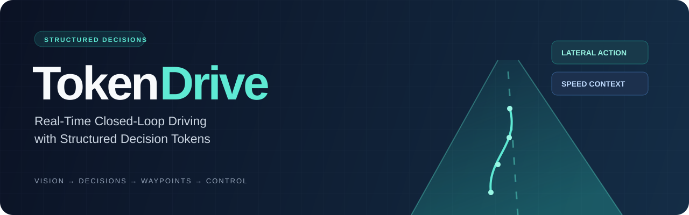
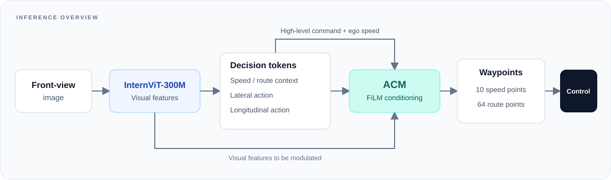

<p align="center">
  
</p>

<p align="center">
  <strong>Real-Time Closed-Loop Driving with Structured Decision Tokens</strong><br>
  A vision-based policy connecting structured decisions to waypoint prediction.
</p>

<p align="center">
  <a href="LICENSE"></a>
  
  
  
</p>

<p align="center">
  <a href="#overview">Overview</a> &middot;
  <a href="#getting-started">Getting started</a> &middot;
  <a href="docs/USAGE.md">Training & evaluation</a> &middot;
  <a href="deployment/pegasus/README.md">Real vehicle</a> &middot;
  <a href="tokendrive/ablation/README.md">Ablations</a> &middot;
  <a href="#repository-map">Code map</a>
</p>

---

## Overview

TokenDrive is an **LM-free end-to-end autonomous driving policy**. Given a front-view image, a high-level command, and ego speed, it predicts structured context and action tokens. An **Action Conditioning Module (ACM)** uses those decisions to modulate visual features through FiLM before waypoint prediction. The online control path does not use autoregressive language generation.

<p align="center">
  
</p>

| Component | Role |
| :--- | :--- |
| **Visual representation** | InternViT-300M-448px with projected patch features. |
| **Structured decisions** | Speed context, route context, lateral action, and longitudinal action tokens. |
| **Action conditioning** | FiLM modulation connects predicted decisions to waypoint features. |
| **Waypoint prediction** | 10 short-horizon speed waypoints and 64 long-horizon route waypoints. |
| **V3 training** | Second-order waypoint smoothness losses for speed and route predictions. |
| **Closed-loop control** | CARLA agent and a SLURM launcher for Bench2Drive evaluation. |
| **Real-vehicle deployment** | Selected v3 C++ inference sources for NVIDIA DRIVE Pegasus, with CUDA preprocessing and CAN-log analysis. |

The diagram summarizes the inference flow; see [`token_drive.py`](tokendrive/models/token_drive.py) and [`token_drive_v3.py`](tokendrive/models/token_drive_v3.py) for the implementation. Encoder freezing is configurable; the checked-in encoder default is `freeze: false`.

## Getting started

The supplied Conda environment targets **Linux / NVIDIA CUDA**. Use a Linux host or an appropriately configured WSL environment.

```bash
git clone https://github.com/jackkim777/TokenDrive.git
cd TokenDrive
conda env create -f environment.yaml
conda activate tokendrive
```

TokenDrive also imports the external `simlingo_base_training` package. Follow the [setup guide](docs/USAGE.md#1-environment-and-upstream-code) to make it available before training.

| Task | Guide | Entry point |
| :--- | :--- | :--- |
| Prepare structured labels | [Data preparation](docs/USAGE.md#2-data-preparation) | [`slots_generator.py`](tokendrive/data_generation/slots_generator.py) |
| Train TokenDrive V3 | [Training](docs/USAGE.md#3-training) | [`train_v3.py`](tokendrive/train_v3.py) |
| Load model weights | [Checkpoint layout](pretrained/README.md) | `pretrained/checkpoints/best.ckpt/` |
| Run closed-loop evaluation | [Evaluation](docs/USAGE.md#4-closed-loop-evaluation) | [`start_eval_tokendrive_v3.py`](start_eval_tokendrive_v3.py) |
| Deploy on DRIVE Pegasus | [Real-vehicle guide](deployment/pegasus/README.md) | [`inference_v3.cpp`](deployment/pegasus/inference_v3.cpp) |
| Study token conditioning | [Ablations](tokendrive/ablation/README.md) | [`compute_delta_wp.py`](tokendrive/ablation/compute_delta_wp.py) |

**Artifact availability.** This repository contains source code and configuration files. Checkpoint binaries, datasets, CARLA, and Bench2Drive assets are external. A TokenDrive checkpoint download URL has not yet been configured in this repository; see [pretrained weights](pretrained/README.md) for the expected files.

## Repository map

```text
TokenDrive/
|-- tokendrive/
|   |-- models/              # Policy, ACM, waypoint heads, vision encoder
|   |-- config/              # Hydra experiments and data configuration
|   |-- dataloader/          # SimLingo-style datasets and datamodules
|   |-- data_generation/     # Structured token label generation
|   |-- ablation/            # Intervention analysis and result aggregation
|   |-- callbacks/           # Training visualization
|   |-- tools/               # Dataset and token summaries
|   `-- train_v3.py          # Main training entry point
|-- team_code/               # CARLA agent, planners, and controllers
|-- pretrained/              # Checkpoint layout; weights excluded
|-- deployment/pegasus/      # Real-vehicle v3 inference and analysis sources
|-- docs/                    # Setup guide and repository visuals
|-- start_eval_tokendrive_v3.py
`-- environment.yaml
```

Start with [`td_v3.yaml`](tokendrive/config/experiment/td_v3.yaml) for the main experiment, [`token_drive_v3.py`](tokendrive/models/token_drive_v3.py) for the V3 loss, and [`agent_token_drive_v3.py`](team_code/agent_token_drive_v3.py) for runtime control.

## License and acknowledgements

TokenDrive is released under the [Apache License 2.0](LICENSE). Portions of the code are adapted from [SimLingo](https://github.com/RenzKa/simlingo); its preserved license is in [`licenses/SimLingo-LICENSE.txt`](licenses/SimLingo-LICENSE.txt). See [third-party notices](THIRD_PARTY_NOTICES.md) for attribution and external dependencies.

The SimLingo dataset has separate license terms and is not redistributed here. Model weights, simulator assets, and benchmark assets remain subject to their upstream terms.
